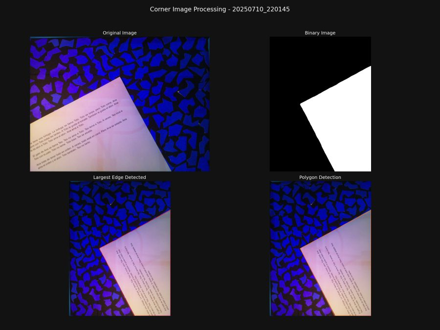
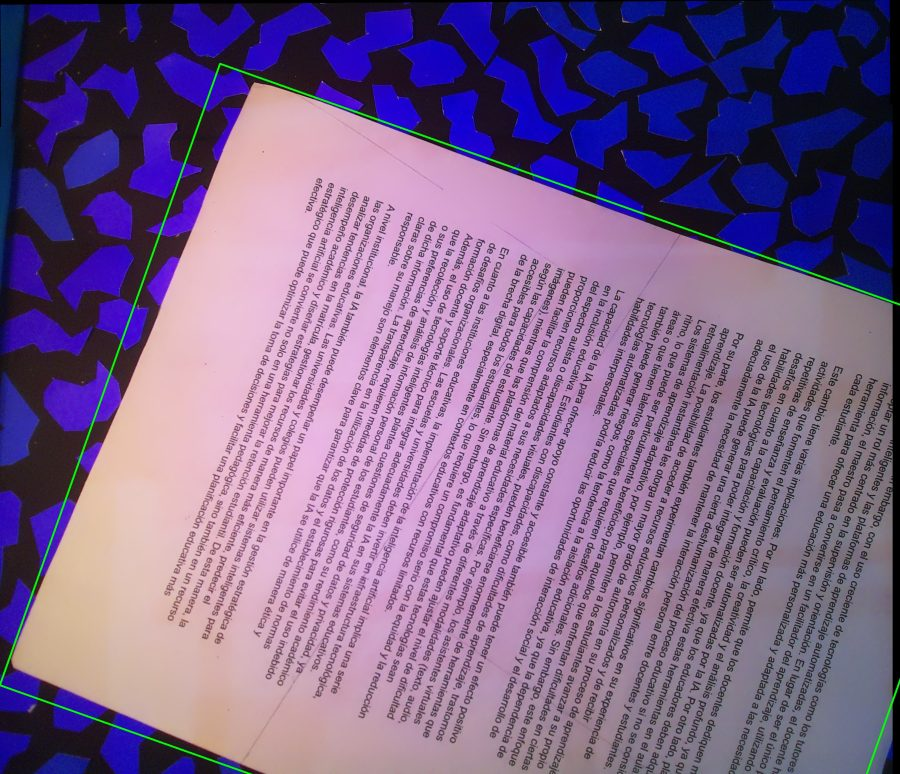

# Capstone 2025-1: Impresora de Braille con escaneo automático

Sistema que **escanea una hoja de texto impreso, lo reconoce con OCR y lo emboza en Braille**, todo de forma automática. Una cámara montada en un carro XY fotografía el papel, el software reconstruye la hoja, extrae el texto, lo traduce a Braille y genera las coordenadas de cada punto para el mecanismo de impresión.

Proyecto del curso Capstone (Pontificia Universidad Católica de Chile), junio–julio 2025.

## Cómo funciona

1. **Homing y calibración**: un Arduino Mega mueve el carro XY (motores paso a paso, finales de carrera, sensores de distancia VL53L0X) y se establece el sistema de referencia en mm.
2. **Detección de la hoja**: se fotografían dos esquinas opuestas con iluminación LED y se detecta el contorno del papel (binarización, bordes, polígono).
3. **Planificación de capturas**: a partir de la posición estimada de la hoja se calculan las posiciones de la cámara con solapamiento suficiente para cubrir todo el papel.
4. **Reconstrucción**: las fotos se unen (*image stitching* con homografías) y se extrae la hoja rectificada.
5. **OCR**: Tesseract (español) obtiene el texto, corrigiendo la orientación de la página.
6. **Traducción a Braille**: soporta mayúsculas, números, ordinales, tildes y símbolos especiales.
7. **Coordenadas de impresión**: cada celda Braille se convierte a coordenadas (x, y) en mm según el estándar de espaciado, y el Arduino emboza cada punto.

| Detección de esquina | Detección de la hoja |
|:---:|:---:|
|  |  |

## Stack

- **Software**: Python, OpenCV, NumPy, Matplotlib, Shapely, pytesseract, pyserial, picamera2
- **Hardware**: Raspberry Pi con cámara, Arduino Mega, motores paso a paso con husillo, LEDs (FastLED), sensores ToF VL53L0X
- **Firmware**: Arduino C++ (`Arduino/main/main.ino`)

## Estructura

```
main.py                  Orquesta el flujo completo (clase Main.flow)
Camera/                  Captura con la cámara y modelo de la caja de cámara
Controllers/             Comunicación serial con el Arduino y gestión de dispositivos
Arduino/main/main.ino    Firmware: movimiento, homing, LEDs, sensores, impresión de puntos
ImageClasses/            Imágenes de esquina, estimación del papel, stitching, OCR
Functions/               Geometría para estimar el polígono del papel y posiciones de fotos
Paper.py                 Papel: posición, esquinas y posiciones de captura
Translator.py            Texto -> Braille (binario de 6 bits por celda)
BrailleToCoordinates.py  Braille -> coordenadas físicas de los puntos
BrailleDicts/            Diccionarios de caracteres, prefijos y ordinales
parameters.json          Parámetros de cámara, papel, OCR y espaciado Braille
```

## Ejecución

Requiere el hardware descrito (Raspberry Pi + Arduino Mega) y Tesseract con el paquete de idioma español.

```bash
pip install -r requirements.txt
sudo apt install tesseract-ocr tesseract-ocr-spa
python -c "from main import Main; Main(1).flow()"
```

Los resultados intermedios (imágenes de depuración y métricas de tiempo) se guardan en carpetas locales ignoradas por git (`FlowImages/`, `debug_imgs/`, `metrics/`).
